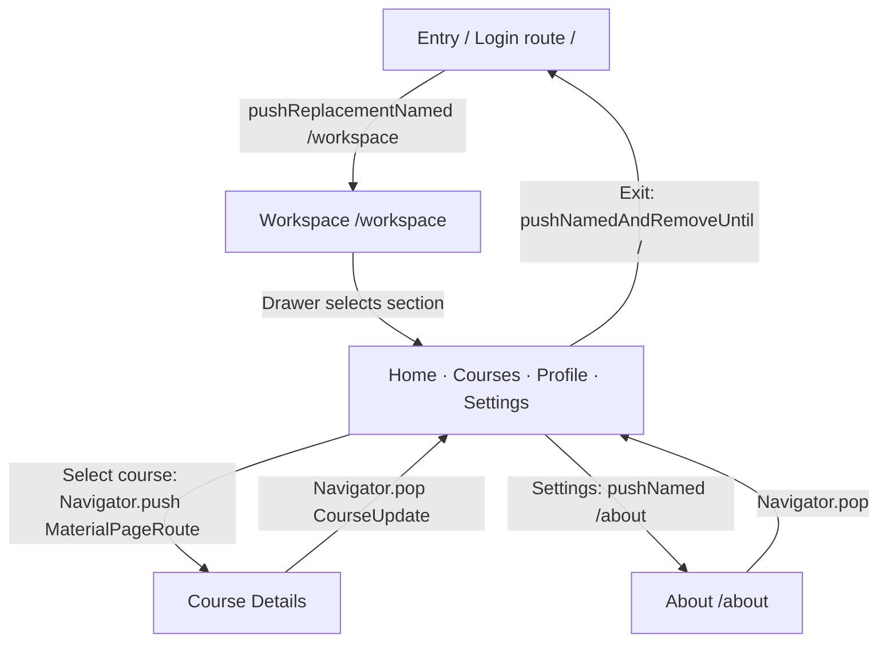

# Navigation diagram — Week 08

## Route stack transitions



### Three navigation systems

1. **Route stack:** Entry is replaced by Workspace; Course Details and About are pushed on top. Back pops those routes.
2. **Drawer:** Home, Courses, Profile, Settings are sections inside an `IndexedStack`; selecting them doesn't create route entries.
3. **Tabs:** The Courses section contains `TabBar` + `TabBarView` for All courses, In progress, and Completed; those tabs also don't create routes.

### Data round trip

```text
Courses (list of Course models)
  → tap course → Navigator.push(MaterialPageRoute(CourseDetailsScreen(course)))
  → user changes favorite / completed locally
  → Save → Navigator.pop(CourseUpdate(courseId, isFavorite, isCompleted))
  → Workspace awaits result → CourseStore.applyUpdate(result)
  → Courses/Home/Profile rebuild via ChangeNotifier
```

Opening Course Details and choosing the system Back button discards edits (returns `null`).
The entry flow is *only a demonstration* and does not authenticate real accounts.
